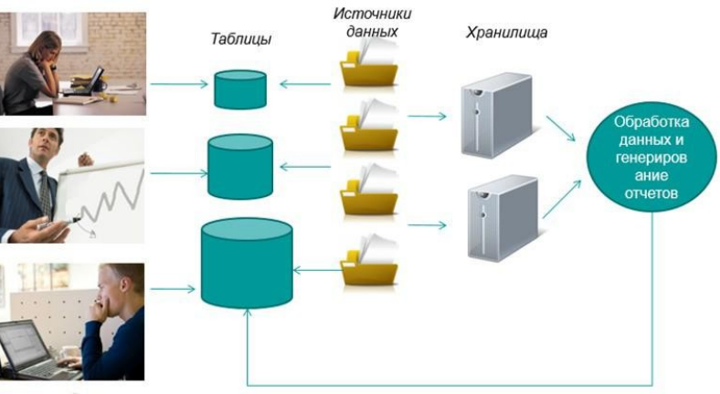
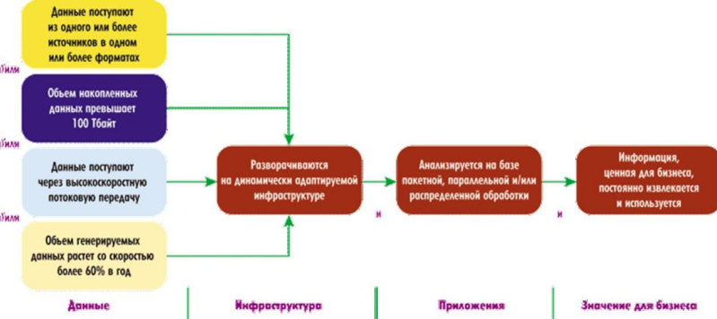

<!-- source: lecture-02 | Анализ БД - Лекция 2 -->

**Лекция 2. Аналитика данных**

**Анализ данных** – это совокупность методов и средств извлечения их организованных данных для принятия решений (рисунок 1.8-1.9).

**Основные этапы анализа данных:**

1. Гипотеза
2. Сбор и систематизация данных
3. Подбор модели
4. Тестирование и интерпретация результатов
5. Использование

**Задачи, решаемые Big Data:**

- Управление документами и доступом
- Выявление мошенничества
- Системы гарантирования доходов
- Анализ текучести клиентов
- Мониторинг интеллектуальных счётчиков
- Мониторинг оборудования
- Оптимизация ценовой политики
- Оптимизация автомобильного движения
- Анализ социальных сетей
- Анализ поведения клиентов
- Оптимизация ИТ инфраструктуры
- Прогноз погоды
- Разведка природных ресурсов
- Управление контентом для предоставления в судебной практике
- Аналитика в медицинских исследованиях
- Управление гарантийными обязательствами
- Анализ рекламных компаний
- Оптимизация web
- Исследования в области естественных наук
- Статистика объёма данных

Каждый день в мире производится 2,5 квинтильона (1018) байтов данных. При этом 90% данных созданы за последние два года.

Каждый час Wal-Mart совершает 1 миллион сделок, пополняя базу данных на 2,5 петабайта (1015) в 170 раз больше объема данных Библиотеки Конгресса США.

Объем отправлений, доставляемых американской Почтовой службой за один год, равен 5 петабайтам, а Google обрабатывает такой же объем данных всего за один час.

Суммарный объем всей существующей на земле информации составляет несколько больше одного зеттабайта (1021).

Бизнесу во всем мире необходимо собрать, организовать, проанализировать все эти данные для достижения конкурентных преимуществ в конкретной сфере рынка, развития более эффективных деловых операций, увеличения удовлетворения запросов потребителей, выявления новых возможностей.
