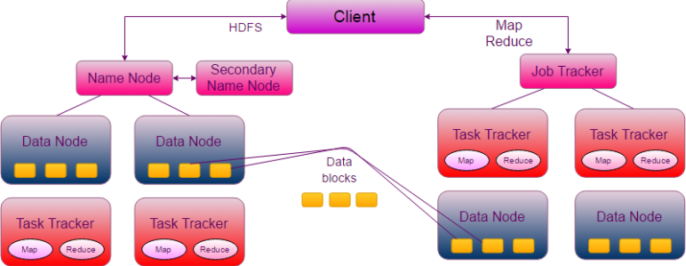

<!-- source: lecture-06 | Анализ БД - Лекция 6 -->

## Лекция 6

В Hadoop MapReduce 1.0 входит единственный узел Job Tracker. Данный узел занимается распределением задач по многочисленным узлам Task Tracker, которые выполняют эти задачи (рисунок 3.5).

При таком подходе происходит перегрузка CPU и сети. Большую часть времени Job Tracker затрачивает на поддержку жизненного цикла Map Reduce задач. Загрузка сети происходит из-за большого централизованного трафика.

В Hadoop MapReduce 1.0 при сбое JobTracker возникает необходимость перезапуска JobTracker с чтением состояния из специальных журналов. Это приводит к простою кластера. Максимальная масштабируемость находится в пределах 4000 узлов. Map Reduce 1.0 не позволял запускать на Hadoop кластере MPI распределённых алгоритмов из-за сильной связанности фреймворка распределённых вычислений и библиотек, выполняющих распределённый алгоритм. В первой версии размер файла по умолчанию составляет 64мб.

### Hadoop Map Reduce 2.0

В Map Reduce 2.0 ответственность по управлению ресурсами и координации за жизненным циклом выполнения приложений разделена между Application Master и Resource Manager (рисунок 3.6).

Каждый узел вычисления разбит на произвольное количество контейнеров (Container). Каждый контейнер содержит определённое количество ресурсов. За контейнером следит Node Manager. В Hadoop MapReduce 2.0 сохраняется состояние компонентов Resource Manager и Application Master и обеспечивается система автоматического перезапуска перечисленных компонентов при сбое с подгрузкой последнего успешно сохраненного состояния. Теоретически Map Reduce 2.0 может содержать до 10000 вычислительных узлов. Во второй версии был выделен фреймворк распределенных вычислений YARN и фреймворк, базирующийся на основе YARN, – MR2. YARN не зависит от специфики распределённого алгоритма в

отличие от MR2.

YARN предоставляет компоненты и API, необходимые для разработки распределенных приложений различных типов, также он берет на себя ответственность по распределению ресурсов в ответ на запросы ресурсов от выполняемых приложений и ответственность за отслеживанием статуса выполнения приложений.

Благодаря YARN на Hadoop-кластере возможно запускать не только

«map/reduce»-приложения, но и распределенные приложения, созданные с использованием: Open MPI, Spark, Apache HAMA, Apache Giraph и др. Есть возможность реализовать и другие распределенные алгоритмы.

### Контрольные вопросы для повторения и самопроверки темы

1. Что такое Apache Hadoop?

2. В чем преимущества решений на базе Hadoop?

3. Что такое MapReduce?

4. Какими достоинствами и недостатками обладает MapReduce?

5. Какому основному принципу следует HDFS?

6. Какой размер блока по умолчанию в HDFS?

7. Какие функции выполняет NameNode в HDFS?

8. Какой узел отвечает за репликацию данных в Hadoop?

9. Какие компоненты содержит Slave узел в Hadoop?

10. Какие компоненты содержит Master узел в Hadoop?

11. Какие компоненты являются частями HDFS?

12. Какое API было добавлено в Hadoop v2.0?

13. Для чего используется автономный режим Hadoop?

14. Какой режим необходим для того, чтобы на локальной машине использовать Hadoop как кластер, состоящий из одного узла?
