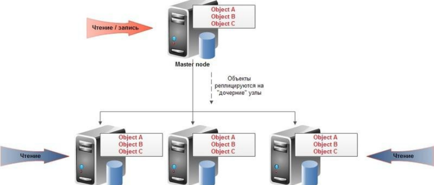
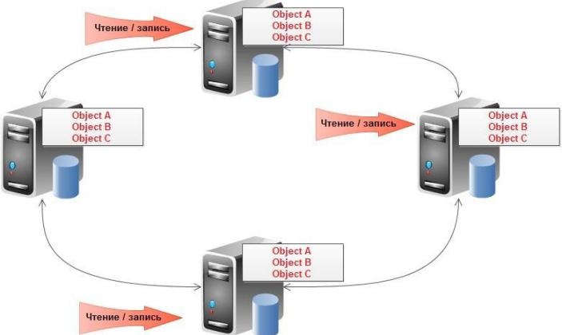
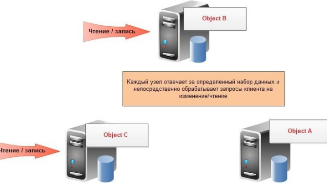
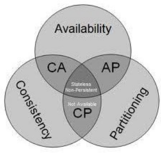

<!-- source: lecture-07 | Анализ БД - Лекция 7 -->

## Лекция 7

**NoSQL. Not Only SQL**

*NoSQL (англ. Not Only SQL, не только SQL)* – термин для ряда подходов, преследующих цель решить такие проблемы, как масштабируемость, доступность, устойчивость к разделению и согласованность данных.

В качестве одного из методологических обоснований подхода NoSQL используется эвристический принцип (теорема CAP), утверждающий, что в распределённой системе невозможно одновременно обеспечить согласованность данных, доступность и устойчивость к расщеплению распределённой системы на изолированные части.

Таким образом, при необходимости достижения высокой доступности и устойчивости к разделению предполагается не фокусироваться на средствах обеспечения согласованности данных, обеспечиваемых традиционными SQL- ориентированными СУБД с транзакционными механизмами на принципах ACID.

### Масштабируемость

Целью является достижение линейности масштабируемости при большом числе узлов, потому как горизонтальное масштабирование, применяемое на традиционных базах данных, обычно является трудоемким и дорогостоящим удовольствием.

Существуют два вида масштабируемости:

*Вертикальное масштабирование:* масштабируемость в этом контексте означает возможность заменять в существующей вычислительной системе компоненты более мощными и быстрыми по мере роста требований и развития технологий. Увеличение производительности каждого компонента системы с целью повышения общей производительности. Это самый простой способ масштабирования, так как не требует никаких изменений в прикладных программах, работающих на таких системах.

*Горизонтальное масштабирование:* масштабируемость в этом контексте означает возможность добавлять к системе новые узлы, серверы, процессоры для увеличения общей производительности. Разбиение системы на более мелкие структурные компоненты и разнесение их по отдельным физическим машинам (или их группам) и (или) увеличение количества серверов, параллельно выполняющих одну и ту же функцию. Этот способ масштабирования может

требовать внесения изменений в программы, чтобы программы могли в полной мере пользоваться возросшим количеством ресурсов.

Для области Big Data интересно горизонтальное масштабирование, так как оно распределенное.

### Репликация

*Репликация* — это копирование данных на другие узлы при обновлении, позволяющее создать полный дубликат базы данных так, что вместо одного сервера их будет несколько, повысить отказоустойчивость, снизить нагрузку на каждый отдельный сервер и как добиться большей масштабируемости, так и повысить доступность и сохранность данных. Включает в себя два вида:

· master-slave

· peer-to-peer

*Репликация Master-Slave* (рисунок 4.1):

Master – это основной сервер БД, куда поступают все данные и где происходят изменения в данных (добавление, обновление, удаление).

Slave – это вспомогательный сервер БД, копирующий все данные с мастера, предназначен только для чтения и может быть в количестве больше одного.

Потому как операций чтения (SELECT) данных часто намного больше, чем операций изменения данных (INSERT/UPDATE), то репликация позволяет таким образом разгрузить основной сервер за счет переноса операций чтения на слейв, потому что в его использовании два или больше одинаковых серверов вместо одного.

*Репликация Peer-to-peer* (рисунок 4.2):

*Одноранговая сеть* – это сеть, которая основывается на равноправии всех участников сети. В данном виде сети отсутствует главный сервер, и каждый узел является как клиентом, так и выполняет функции сервера.

Сама по себе репликация не самый удобный механизм масштабирования, так как происходит рассинхронизация данных и возможны задержки в копирования с мастера на слейв. Но вместе с тем это отличное средство для обеспечения отказоустойчивости, потому как всегда можно переключиться на слейв в случае отказа мастера. Для надежности обычно используется совместно с шардингом.

*Шардинг* (рисунок 4.3):

*Шардинг* –это другая техника масштабирования работы с данными, суть которой заключается в разделении базы данных на отдельные части так, чтобы каждую из них можно было вынести на отдельный сервер. Этот процесс зависит от структуры базы данных и выполняется прямо в приложении, в отличие от репликации. Существуют два типа шардинга:

*Вертикальный шардинг* – это выделение таблицы или группы таблиц на отдельный сервер.

*Горизонтальный шардинг* – это разделение одной таблицы на разные сервера. Это необходимо использовать для огромных таблиц, которые не умещаются на одном сервере. Разделение таблицы на куски делается по такому принципу:

1. На нескольких серверах создается одна и та же таблица (только структура, без данных).

2. В приложении выбирается условие, по которому будет определяться нужное соединение (например, четные на один сервер, а нечетные – на другой).

3. Перед каждым обращением к таблице происходит выбор нужного соединения (допустим, для нечетных пользователей мы будем работать с первым сервером, а для четных – со вторым).

### CAP – теорема

*Теорема CAP* (известная также как теорема Брюера), – эвристическое утверждение о том, что в любой реализации распределённых вычислений возможно обеспечить не более двух из трёх следующих свойств (рисунок 4.4):

1. Согласованность данных (англ. **С** onsistency) – во всех вычислительных узлах в один момент времени данные не противоречат друг другу. Как только мы успешно записали данные в наше распределенное хранилище, любой клиент при запросе получит эти последние данные.

2. Доступность (англ. **A** vailability) – любой запрос к распределённой системе завершается корректным откликом. В любой момент клиент может получить данные из нашего хранилища или получить ответ об их отсутствии, если их никто еще не сохранял.

3. Устойчивость к разделению (англ. **P** artition tolerance) – расщепление распределённой системы на несколько изолированных секций не приводит к некорректности отклика от каждой из секций. Потеря сообщений между компонентами системы (возможно даже потеря всех сообщений) не влияет на работоспособность системы. Здесь очень важный момент состоит в том, что если какие-то компоненты выходят из строя, то это тоже подпадает под этот случай, так как можно считать, что данные компоненты просто теряют связь со

всей остальной системой.

*Следствие из теоремы CAP*

**CA** : Система, во всех узлах которой данные согласованы и обеспечена доступность, жертвует устойчивостью к распаду на секции. Такие системы возможны на основе технологического программного обеспечения, поддерживающего транзакционность в смысле ACID. Примерами таких систем могут быть решения на основе кластерных систем управления базами данных или распределённая служба каталогов LDAP.

**CP** : Распределённая система, в каждый момент обеспечивающая целостный результат и способная функционировать в условиях распада в ущерб доступности, может не выдавать отклик. Устойчивость к распаду на секции требует обеспечения дублирования изменений во всех узлах системы, в этой связи отмечается практическая целесообразность использования в таких системах распределённых пессимистических блокировок для сохранения целостности.

**AP** : Распределённая система, отказывающаяся от целостности результата. Хотя системы такого рода известны задолго до формулировки принципа CAP (например, распределённые веб-кэши или DNS), рост популярности систем с этим набором свойств связывается именно с распространением теоремы CAP. Так, большинство NoSQL-систем принципиально не гарантируют целостности данных и ссылаются на теорему CAP как на мотив такого ограничения. Задачей при построении AP-систем становится обеспечение некоторого практически целесообразного уровня целостности данных, в этом смысле про AP-системы говорят как о «целостных в конечном итоге» (англ. eventually consistent) или как о «слабо целостных» (англ. weak consistent).

Перейдем к определению ACID, что расшифровывается как:

**A** tomicity – транзакции атомарны, то есть либо все изменения транзакции фиксируются (commit), либо все откатываются (rollback).

**C** onsistency – транзакции не нарушают согласованность данных, то есть

они переводят базу данных из одного корректного состояния в другое. Тут можно упомянуть допустимые значения полей, внешние ключи и более сложные ограничения целостности.

**I** solation – работающие одновременно транзакции не влияют друг на друга, то есть многопоточная обработка транзакций производится таким образом, чтобы результат их параллельного исполнения соответствовал результату их последовательного исполнения.

**D** urability – если транзакция была успешно завершена, никакое внешнее событие не должно привести к потере совершенных ей изменений.
