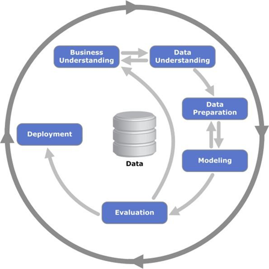

<!-- source: lecture-12 | Анализ БД - Лекция 12 -->

## Лекция 12. Классификация задач анализа данных

Определение DataMining

Data Mining (добыча данных, интеллектуальный анализ данных (ИАД), глубинный анализ данных) – собирательное название, используемое для обозначения совокупности методов обнаружения в данных ранее неизвестных, нетривиальных, практически полезных и доступных интерпретации знаний, необходимых для принятия решений в различных сферах человеческой деятельности. Термин введён Григорием Пятецким-Шапиро в 1989 году.

### Предмет интереса для анализа

- · Нетривиальные знания
- · Неявные зависимости
- · Ранее неизвестные знания
- · Практически полезные знания
- · Доступные для интерпретации

Рисунок 6.1 – Ключевые шаги DataMining

### Отличия от традиционного анализа

- 
  - 
    - 
      - Огромные объемы данных (требуются масштабированные алгоритмы для террабайтных БД)
      - Данные высокой размерности (до десятков тысяч измерений)
      - Высокая сложность данных
      - Данные временных рядов, временные данные, данные последовательностей событий
      - Структурные данные, графики, социальные отношения, данные со множественными ссылками
      - Гетерогенные источники данных, БД
      - Пространственные, пространственно-временные, мультимедиа, текстовые и Web-данные

### Задачи ИАД

Описательные: наглядное описание имеющихся скрытых закономерностей

Предсказательные: предсказание для тех случаев, для которых данных ещё нет

### Виды ИАД

- Выявление ассоциативных связей
- Определение закономерностей в событиях или процессах
- Ассоциативная связь различных фактов одного событияРезультат:
- Лучшее понимание природы процессов
- Прогнозирование новых событий
- Кластеризация объектов
- Разделение исследуемого множества объектов на группы (кластеры) по принципу сходства.
- В процессе кластеризации методами ИАД определяются схожие характеристики объектов, на их основе объекты объединяются.
- Классификация
- Отнесение объектов к одному из известных классов на основе их характеристик
- Задачи регрессии
- Задача определения значения одного из параметров анализируемого объекта на основе других характеристик
- Все характеристики - количественные

### Практическое занятие 8. Типы Data Minig

Сфера применения Data Mining ничем не ограничена, Data Mining нужен везде, где имеются какие-либо данные.

- Анализ рыночных корзин
- Управление взаимоотношениями с клиентами
- Анализ текстовой информации (Text Mining)
- Анализ информации, порождаемой в сети Интернет (Web Mining)
- Анализ социальных медиа (Social Mining)

Анализ рыночной корзины (market basket analysis) – это поиск наиболее типичных, шаблонных покупок в супермаркетах (поиск ассоциативных правил).

Анализ рыночной корзины производится путем анализа баз данных с целью определения комбинаций товаров, которые связанны между собой. В каждой такой паре один товар будет ключевым, а товар, покупаемый вместе с ним – сопутствующим.

Подобный анализ позволит выявить частоту покупки парных товаров, а также вероятность с которой сопутствующий товар покупается вместе с ключевым.

### Text Mining

Анализ структурированной информации (например, в БД) уже довольно непростая задача. Но не все виды данных можно успешно структурировать. Например, текстовые документы практически невозможно структурировать без потери семантики и смысловых отношений.

Методы анализа текстов лежат на стыке нескольких областей:

- Data Mining
- обработкаестественныхязыков (NLP - Natural Language Processing)
- поиск и извлечение информации

Text Mining – это нетривиальный процесс обнаружения действительно новых, потенциально полезных и понятных шаблонов в неструктурированных текстовых данных. Ключевая особенность - "неструктурированные текстовые данные".

Ключевые задачи интеллектуального анализа текстов:

- Категоризация текстов, классификация
- Извлечение информации и информационный поиск

### Web Mining

Web Mining – это использование методов интеллектуального анализа данных (Data mining, ИАД) для автоматического обнаружения веб-документов и услуг, извлечения информации из веб-ресурсов и сервисов.

Веб-пространство – огромная, широко распространенная информационная сеть, которая включает:

- Информационные сервисы
- Новости, реклама, потребительская информация
- Финансовые рынки, образовнаие, правительство
- Электронная коммерция, развлекательные ресурсы, социальные медиа
- Гипер-текстовая информация (Hyperlinks)
- База данных статистики использования ресурсов Веб-информация – это:
- Web Content – текст, изображения, таблицы и т.д.
- Web Structure – гиперссылки, тэги, и т.д.
- Web Usage – логи веб-серверов, прокси

Выделяют различные категории Web Mining в зависимости от предмета интереса:

- Web Content Mining – извлечение знаний непосредственно из контента
- Web Usage Mining – анализ использования веб-ресурсов
- Web Structure Mining – выявление моделей, лежащих в основе ссылочной структуры сети

### Web Content Mining

Задача: автоматизация поиска информационных ресурсов в Интернете, включая в себя добычу содержимого из веб-данных

Веб-данные:

- Текст
- Изображения
- Аудио-данные
- Видео-данные
- Мета-данные и гиперссылки

### Web usage analysis

Каждая страница содержит какую-либо информацию. Гиперссылка – своеобразная “связь” между двумя страницами. Изучая поток кликов по ссылкам, можно понять, как пользователи перемещаются по веб-страницам, шаблоны их поведения

### Web Usage Mining (анализ кликов)

Зачем анализировать использование веб-сайта, понимать паттерны пользователей?

- Улучшение клиенто-ориентированности веб-сайта
- Помощь в предотвращении дезориентации
- Лучшие практики по размещению важной информации на странице (именно там, где ее ищет пользователь)
- Предварительная загрузка и кеширование необходимых веб-страниц Вопросы, на которые можно получить ответы:
- Есть ли различия в шаблонах действий различных пользователей, от чего они зависят?
- Как меняется поведение пользователей с течением времени?
- Как распределяется сетевая нагрузка в течение дня?

### Web structure mining

Гиперссылки – ключевая часть технологии Интернет. Через ссылки выражается взаимосвязь между отдельными веб-страницами. Внутри модели связи страниц в Интернете также могут лежать значимые знания и законы.

Web Structure Mining – это процесс выявления структуры ссылок и модели, лежащей в основе ссылочной структуры в Интернете.

Что может Web Structure Mining?

- Модель, основанная на топологии гиперссылки может быть использована для классификации Веб-страницы (отнесения ее к какой-либо категории)
- Получение информации о сходстве и отношениях между веб-сайтами
- Определение наиболее авторитетных страниц по отношению к заданным критериям поиска.
- Данный подход широко используется в веб-поиске и ранжировании страниц. (поисковые системы)

### Social media mining

Social Media – массовая коммуникация посредством сети Интернет. Изначальная идея – приложения в сети Интернет, основанные на идеях Web 2.0, позволяющие создавать и обмениваться пользовательским контентом (user- generated content). Большое количество такого контента сейчас создается на таких ресурсах, как Facebook, Twitter, Google+.

Системный анализ, поиск скрытых ценных знаний из социальных медиа – Social Data Mining.

Особенности:

- Пользовательской информации очень много
- Но и “шумов” в ней тоже много
- Распределена по разным источникам
- Слабоструктурированная, а большинство не структурирована вовсе
- Динамичная, обновляется постоянно

### Почему важно?

- Каждый день количество информации, размещенной пользователями растет, очень малое количество обрабатывается
- Платформа для маркетинга и рекламы
- Моделирование поведенческих законов
- Предсказательный анализ
- Рекомендательный контент

### RapidMiner

RapidMiner – инструмент, созданный для Data Mining. Основная идея – аналитик не должен программировать при выполнении своей работы.

- Свободная лицензия, Open Source
- Разработан на Java, кроссплатформенность

Доступен на Github Достоинства:

- Достаточно хороший набор операторов, решающих большой спектр задач получения информации из разнообразных источников
- Базы данных
- Файлы
- URL
- Большая коллекция операторов обработки информации
- Фильтрация
- Аггрегация
- Сортировка Недостатки:
- Несмотря на обилие моделей анализа в стандартном пакете, иногда их бывает недостаточно для выполнения сложных задач
- Нет возможности добавлять собственные модели и операции

Идея – визуальное программирование. Процесс – совокупность операторов, соединенных между собой в заданном порядке для выполнения требуемой задачи анализа/обработки данных. Оператор – логическая единица процесса. Оператор производит действия над данными. У него есть вход-выход («порты»), на вход приходят данные, на выход идут обработанные оператором данные. Несколько операторов в рамках процесса позволяют составлять цепочки обработки данных. К примеру, начать с считывания транзакций из БД, найти самые большие, сконвертировать в доллары и выдать результат. Цепочки операторов возможно параллелить.

Можно с уверенностью говорить, что RapidMiner – полноценный инструмент для ETL. Спектр решаемых задач:

- Сбор информации с источников (файлы, БД, URL и др.)
- Простая статистическая обработка данных (фильтрация, агрегация, и т.д.)
- Аналитическое моделирование (классификация, нейронные сети и т.д.)
- Валидация моделей
- Визуализация результатов (хоть и идостаточно примитивная)

### Контрольные вопросы для повторения и самопроверки темы

1. Чем анализ больших данных отличается от традиционного анализа?
2. Какие основные типы Data Mining?
3. Какие категории Web Mining можно выделить?
4. В чем основная задача Web Content Mining?
5. В чем основные задачи интеллектуального анализа текстов?
