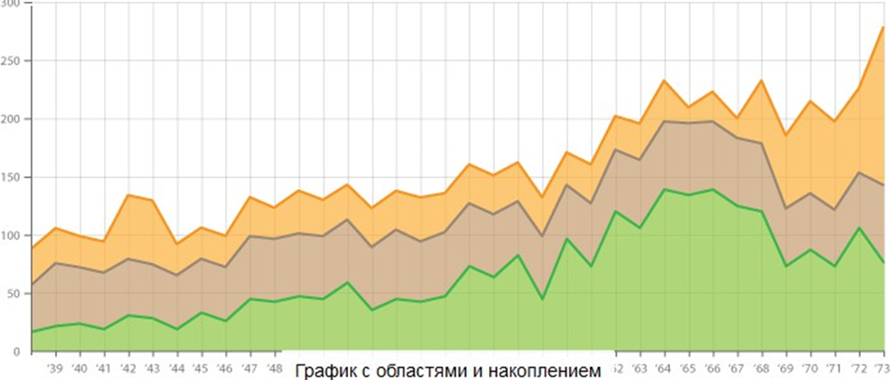
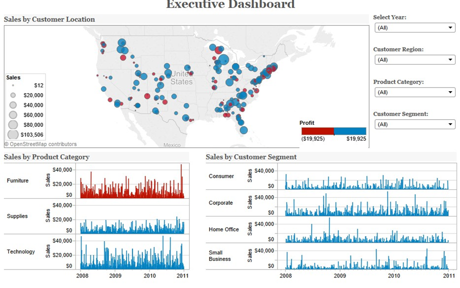
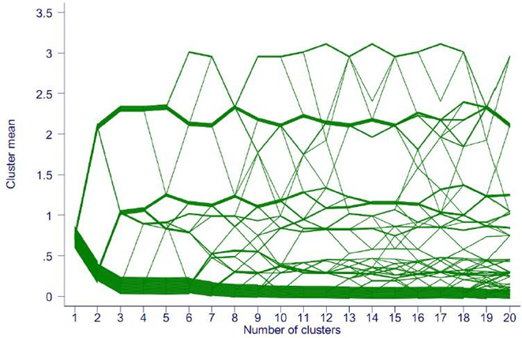

<!-- source: practice-09 | Анализ БД - Практика 9 -->

**Характеристики Big Data**

Можно сформулировать требования к такого рода визуализации:

- оценка пригодности (адекватности в визуализации) видов отображения,
- естественность (привычность для пользователей),
- устойчивость к масштабированию,
- возможность вывода сверхбольших объемов данных,
- возможности для представления сложных структур, а также объектов особого интереса, особых точек, аттракторов, сингулярностей.

Как решить проблемы визуализации BigData? Необходимо:

- использовать достаточно простые, но четко интерпритируемые мотоды представления.
- формализовывать описания объектов программного обеспечения
- производить верификацию и валидацию визуализации.

### Традиционные виды визуализации

- Рассмотрим традиционные виды визуализации.
- Графики и диаграммы
- Инфографика и схемы
- Презентация и анализ данных
- Интерактивный сторителлинг
- Бизнес аналитика и дашборды
- Научная и медицинская визуализация
- Карты и картограммы

### Лекция 10. Графики и диаграммы

Наверное, самый привычный вид визуализации данных (рисунок 5.1).

Используется как для презентации данных, так и для анализа. Встретить их можно и на работе, и в журнале, и в научном отчете. Обычно знания о существующих типах диаграмм и графиков мы получаем из школы или из стандартного набора в Excel. Однако мир графиков и диаграмм не ограничивается точечным графиком, столбиковой и круговой диаграммой. Существуют порядка 15 общеизвестных типов диаграмм, а всего их более 60, при этом их количество увеличивается с каждым днём – люди придумывают новые типы для визуализации сложных и необычных данных.

Рисунок 5.1 – Пример визуализации в виде графика

### Инфографика

Инфографика стала очень популярна в последние годы, хотя существуют уже давно. Инфографика относится к журналистике данных, где графики и схемы объясняют какие-либо факты по выбранной теме. Обычно инфографика статична и представляет собой длинную «простыню» с картинками и текстом. Отличительной особенностью инфографики является то, что в ней приводятся уже готовые выводы, то есть читателя проводят за руку по выбранной теме и при этом приправляют это все цифрами и картинками. Часто используется рисованный или анимационный стиль. Часто используется не к месту или «для красоты», хотя конечно же есть замечательные и интересные примеры.

### Презентация и анализ данных

Один самых привычных способов использования визуализации данных - презентация информации в виде диаграмм или инфографики. И если с этим все понятно, то использование визуализации для анализа информации в основном используется только бизнес-аналитиками и учеными. В чем заключается отличие?

При анализе данных с помощью визуализации используют так называемое быстрое прототипирование – то есть создание большого количества различных визуальных представлений одних и тех же данных. Делается это для возможности нахождения скрытых, на первый взгляд, взаимосвязей и зависимостей, а также первичной оценки набора данных для возможности применения в дальнейшем более сложных инструментов анализа. Этот подход называется Exploratory data analysis (EDA), что на русский можно перевести как разведывательный анализ данных. Основное отличие от презентации данных - визуализация здесь может быть «черновой», но выполняется быстро и одним человеком или небольшой рабочей группой.

### Интерактивный сторителлинг

Сторителлинг – это преподнесение какой-либо полезной информации в форме интересного рассказа. Интерактивный сторителлинг – рассказ, с которым слушатель может взаимодействовать. Пользователь может управлять отображением информации и находить те зависимости, которые не нашёл автор. В этом смысле он близок к разведывательному анализу данных, но отличается тем, что данные заранее обработаны и представлены в удобном для анализа виде, а также имеются подсказки или заранее прописанные сценарии использования.

Поэтому, чаще всего интерактивный сторителлинг называют интерактивной инфографикой, но для того чтобы ей стать недостаточно просто к статичной инфографике добавить всплывающие окошки.

### Дашборды и бизнес аналитика

Визуализация активно используется в бизнесе. Принцип «говорите с данными» помогает компаниям зарабатывать больше, а клиентам получать лучший сервис. Для разового анализа обычно используется Excel или R. Однако это неудобно если необходимо следит за какими-то показателями на постоянной основе. Для отслеживания используют дашборды – дисплеи, на которых выведены все необходимые показатели в одном месте в виде графиков, диаграмм и таблиц. Проектирование эффективных дашбордов – сложная и неординарная задача. Зачастую их перегружают ненужной информацией или стараются использовать все возможные типы шаблонных графиков. Часто для того, чтобы спроектировать хороший дашборд, необходимо создание новых типов визуализации информации. Тематика активно развивается за счет все большего применения аналитики в бизнесе. Также дашборды применяются и для личного использования (фитнес трекеры, анализ личных расходов и т. п.)

Рисунок 5.2 – Пример дашборда

### Визуализация в медицине и науке

Специфический вид визуализации. Его целью обычно является выделение закономерностей или аномалий. От обычной визуализации данных отличается тем, что часто бывает трёхмерной и требует специальной подготовки для интерпретации.

### Карты и картограммы

Карты – одни из древнейших способов визуализации, отображающих окружающую реальность. Картограмма – карта с нанесенной на неё информацией в виде цвета или других способов. Картограммы могут быть использованы для отображения любой информации – от плотности населения, до частоты использования мобильных телефонов в каждом районе страны.

### Облако тегов

Каждому элементу в облаке тегов присваивается определенный весовой коэффициент, который коррелирует с размером шрифта. В случае анализа текста величина весового коэффициента напрямую зависит от частоты употребления (цитирования) определенного слова или словосочетания.

Позволяет читателю в сжатые сроки получить представление о ключевых моментах сколько угодно большого текста или набора текстов.

### Кластерграмма

Метод визуализации, использующийся при кластерном анализе (рисунок 5.3). Показывает, как отдельные элементы множества данных соотносятся с кластерами по мере изменения их количества. Выбор оптимального количества кластеров – важная составляющая кластерного анализа.

Рисунок 5.3 – Пример кластерграммы

### Исторический поток

Помогает следить за эволюцией документа, над созданием которого работает одновременно большое количество авторов. В частности, это типичная ситуация для сервисов wiki в том числе. По горизонтальной оси откладывается время. По вертикальной - вклад каждого из соавторов, т.е. объем введенного текста. Каждому уникальному автору присваивается определенный цвет на диаграмме

### Пространственный поток

Используется для отслеживания пространственного изменения информации.
