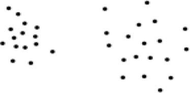
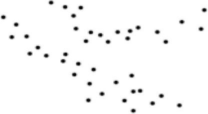
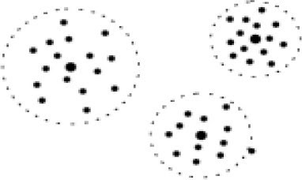
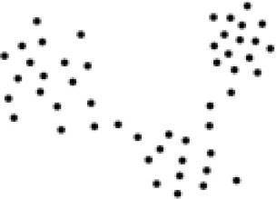
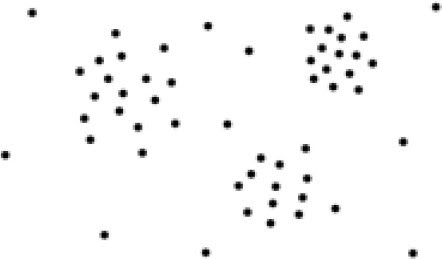
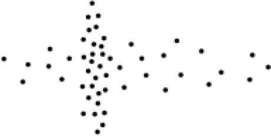

<!-- source: practice-14 | Анализ БД - Практика 14 -->

**Кластерный анализ**

*Кластеризация – это обучение без учителя.*

*Кластеризация* – это задача разделить множество объектов на различные группы, которые называются кластерами.

Целью кластеризации является:

· Упрощение дальнейшей обработки данных – разбиение пространства объектов на группы схожих между собой объектов для работы с каждой группой по отдельности (классификации, регрессии, прогнозирования);

· Сокращение объема хранимых данных – оставление по представителю каждого из кластеров (сжатие данных);

· Выделение нетипичных объектов – тех, что не удовлетворяют потребностей кластеров (одноклассовая классификация);

· Построение иерархии множества объектов – таксономия.

Дается ***X*** – пространство объектов, ***X*** ***^n*** ***={x*** ***_i*** ***}*** ***^n*** ***_i=1*** – обучающая выборка и ***p:X*** ´***X → [0, ∞)*** – функция расстояния между объектами. И необходимо найти множество кластеров ***Y*** – и алгоритм кластеризации – ***α: X→Y*** , такой, что каждый кластер состоит из близких объектов и объекты разных кластеров существенно различаются.

Некорректностью задачи кластеризации является её неоднозначность, потому как:

· Четкой постановки задачи не существует;

· Большое количество критериев качества кластеризации;

· Большое количество эвристических методов деления на кластеры;

· Число кластеров заранее неизвестно;

· Результат зависит от субъективной метрики ***p*** . Типы кластерных структур:

1. С расстояниями внутри кластера меньше, чем между ними.

2. Ленточные кластеры.

3. Кластеры с центром.

4. Соединенные кластеры.

5. Наложенные на фон разреженных объектов.

6. Перекрывающие кластеры.

Каждый метод кластеризации имеет свои ограничения и выделяет кластеры лишь некоторых типов. Понятие «Тип кластерной структуры» зависит от метода и не имеет формального определения. Самыми известными методами кластеризации являются Метод К-средних, Метод С-средних, Сеть Кохонена и другие. Которые теперь разберем поподробнее.
